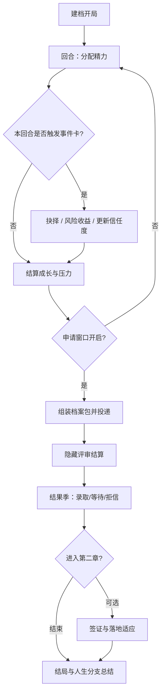

# 《留学模拟器》游戏设计文档

> 状态：设计讨论中 · 版本：v0.1 草案 · 最后更新：2026-11-01  
> 开放问题见 [DISCUSSION.md](./DISCUSSION.md)

---

## 1. 愿景与定位

### 1.1 产品一句话

《留学模拟器》是一款**回合制人生模拟 + 事件卡牌 + 轻策略资源分配**游戏：玩家在有限申请季里经营多维成长与信息不对称，最终把「档案包」投向目标院校，体验真实申请压力与人生选择，而不是刷分答题。

### 1.2 目标体验

| 关键词 | 含义 |
|--------|------|
| 紧张但公平 | 资源永远不够用，但失败可归因于信息判断与取舍，而非随机虐心 |
| 有笑点与扎心 | 轻讽刺现实主义：论坛谣言、中介话术、父母期望——好笑也刺痛 |
| 重玩想换策略 | 不同起点、目标国/专业、人生分支 → 不同最优解 |

### 1.3 受众

- **核心**：打算留学或正在申请的学生（压力宣泄 + 认知预习）
- **扩展**：喜欢人生模拟、轻度策略、事件抉择的玩家
- **非目标**：硬核模拟经营党、纯答题刷分党、开放世界探索党

### 1.4 核心创意卖点（突出）

1. **档案一致性**  
   不是单项刷满，而是「故事能不能讲圆」——活动、文书、面试话术若互相矛盾会减分。

2. **信息战**  
   假情报与真机会混杂；学会查证本身是技能，不是 flavor text。

3. **心理与家庭作为系统资源**  
   焦虑、期望、金钱不只是旁白；它们挤压或解锁行动槽。

4. **隐藏评审官口味**  
   不同学校偏好学术 / 实践 / 多样性叙事，需用情报与试探去逼近。

5. **可重玩的人生分支**  
   学术型 / 就业导向 / 移民路径 / 「其实更想留下」等结局分叉。

---

## 2. 推荐玩法形式（及为何不选其他）

### 2.1 推荐形态

**学期 / 周为回合的资源管理 + 事件卡驱动叙事 + 申请提交与隐藏评审**

灵感合成（仅机制借鉴，不抄袭内容）：

- **Papers, Please** 式信息判断感：材料是否自洽、情报是否可信
- **The Sims** 式日程分配：有限精力挤进互相冲突的槽位
- **Reigns / 事件卡** 式抉择密度：一张卡、几个选项、连锁后果

### 2.2 为何不选其他形式

| 形态 | 问题 | 结论 |
|------|------|------|
| 纯文字冒险 | 重故事但策略感弱，重玩价值低 | 叙事可嵌在事件卡里，不做主结构 |
| 纯经营数值堆砌 | 易变成 Excel，缺留学特有的「叙事与身份」 | 数值要有，但以档案一致性与情报为上层 |
| 开放世界 RPG | 开发成本过高；留学核心是**时间窗与抉择**，不是探索 | 不做大地图探索 |

---

## 3. 核心玩法循环

### 3.1 闭环概览

1. **建档开局**：选起点（高中 / 大一～大三、家庭资源、目标国家 / 专业方向）
2. **回合经营**：每回合有限「精力 / 时间」分配到 GPA、语言、科研 / 作品、实习、文书、社交、打工、心理恢复等槽位；槽位互相挤压
3. **事件卡**：教授机会、组会翻车、文书灵感 / 崩溃、签证政策、父母施压、同辈比较、中介话术、论坛谣言等——带风险与收益，且信息不完全可信
4. **信息不对称**：情报来自官网、学长、中介、论坛；玩家需判断可信度；学校评审权重对玩家半隐藏
5. **申请窗口**：组「档案包」（成绩、标化、文书主题、推荐信关系、活动叙事一致性）并投递；多校策略（冲刺 / 稳妥 / 保底）
6. **结果与余波**：录取 / 等待 / 拒信；选校；可选第二章：签证与落地适应

### 3.2 伪流程（Mermaid）



### 3.3 一局节奏（示意）

- **前期养成**（若干回合）：打底 GPA / 语言 / 活动叙事种子  
- **申请季**（压缩回合）：文书、推荐信、投递策略、情报高峰  
- **结果季**：等待邮件、补材料、选校；可选进入第二章  

---

## 4. 系统拆解

### 4.1 时间 / 精力

- 每回合固定 **精力点（AP）**；部分事件消耗或返还 AP。
- 槽位互斥：同一回合「肝科研」与「打工赚钱」会抢同一资源池。
- 长期 debuff：连续高压会降低有效 AP（见心理健康）。

### 4.2 成长维度（示例槽位）

| 维度 | 作用 | 挤压关系示意 |
|------|------|--------------|
| GPA / 课业 | 硬门槛与部分学校权重 | 与实习、社交抢时间 |
| 语言 / 标化 | 门槛 + 部分学校加分 | 刷分易挤占文书与心理健康 |
| 科研 / 作品集 | 学术叙事核心 | 高收益高翻车风险 |
| 实习 / 实践 | 就业向叙事 | 与课业、科研冲突 |
| 文书 / 叙事打磨 | 档案一致性引擎 | 需要「素材」来自其他槽位 |
| 社交 / 推荐信关系 | 解锁推荐人与情报 | 浅社交无效，深关系耗时 |
| 打工 / 经济 | 支撑申请费与中介费 | 直接挤成长 |
| 心理恢复 | 维持可持续 AP | 「躺平」回合有叙事代价（家庭期望） |

> 设计原则：**没有最优单项；最优是叙事能圆、门槛够得着、压力不崩盘。**

### 4.3 事件卡

- **结构**：标题 + 叙述 + 2～4 选项 + 显性/隐性标签（风险、收益、可信度提示可选）
- **主题池（示例）**：教授临时机会、组会翻车、文书灵感 / 崩溃、签证政策波动、父母施压、同辈比较、中介话术、论坛谣言、奖学金线索、健康小插曲
- **不完全信息**：同一事件在不同情报可信度下，选项结果分布不同
- **连锁**：短期 buff/debuff、解锁/锁死某条叙事线、改变家庭期望压力

### 4.4 情报系统

| 来源 | 典型特征 | 玩家技能点 |
|------|----------|------------|
| 官网 / 官方手册 | 可信度高但抽象 | 解读门槛与截止日期 |
| 学长 / 学姐 | 中高可信，带个案偏差 | 对照自己档案 |
| 中介 | 混杂推销动机 | 识别话术与利益冲突 |
| 论坛 / 群聊 | 噪声大，偶有金矿 | 交叉验证 |

- **可信度**可作为隐藏或半隐藏数值；查证行动消耗 AP，但降低踩坑概率。
- **假机会**（付费内推、神文书模板）应有可发现的破绽，避免纯随机惩罚。

### 4.5 申请与评审

**档案包组成（示意）**

- 硬指标：GPA、标化、语言
- 软叙事：活动时间线、文书主题、推荐信关系强度与匹配度
- **一致性分数**：活动—文书—面试话术的矛盾会扣分（核心卖点）

**多校策略**

- 冲刺 / 稳妥 / 保底名额有上限（精力与文书定制成本）
- 同一文书海投会降低一致性或「学校契合」评分

**隐藏评审**

- 各校（或校类型）有半隐藏权重：学术深度、实践影响、多样性 / 身份叙事、领导力等
- 玩家通过情报、往届结果卡片、模拟面试反馈逼近真实权重
- 结算可展示「你以为的理由」vs「实际主因」的部分揭示，服务学习与重玩

### 4.6 经济与家庭

- **金钱**：申请费、考试费、中介、旅行面试、生活费；来源包括家庭拨款与打工
- **家庭期望**：期望过高 → 压力与资源双高；期望错位 → 冲突事件与「其实更想留下」分支
- 家庭不是纯 debuff：资源、人脉、情感支持也可正面触发

### 4.7 心理健康

- **焦虑 / 倦怠** 影响有效 AP、事件选项质量、文书「灵感」触发率
- 恢复手段：休息、社交倾诉、运动、降低目标强度（带叙事代价）
- 设计目标：让「心理」成为可管理的系统资源，而不是说教弹窗

---

## 5. 进度结构

```text
开局建档
   ↓
前期养成（打底 + 叙事种子 + 情报习惯）
   ↓
申请季（文书高峰、投递、信息战白热化）
   ↓
结果季（录取/等待/拒信、选校、余波事件）
   ↓
（可选）第二章：签证、行前、落地适应与文化冲击
   ↓
结局结算：人生分支标签 + 一句话墓志铭式总结（幽默向）
```

**人生分支示例（非穷尽）**

- 学术深造型
- 就业导向型
- 移民路径型
- 「其实更想留下 / 换赛道」型
- 高压力通关但关系破裂型（警示向结局，仍应公平可避免）

---

## 6. 美术 / 叙事基调建议

- **基调**：轻讽刺现实主义——承认焦虑与荒诞，但不贩卖绝望
- **语气**：能笑着点头的扎心；避免说教、鸡汤、贬低任一选择
- **视觉方向（待拍板）**：简洁 UI 经营面板 + 插画事件卡；或偏视觉小说立绘——见 DISCUSSION
- **角色**：玩家自建浅层人设即可；NPC（导师、家长、室友、顾问）用鲜明话术标签区分情报动机

---

## 7. MVP 范围与非目标

### 7.1 MVP（最小可玩版本）应有

- [ ] 一种起点模板 + 有限自定义（国家 / 专业方向二选一深度即可）
- [ ] 完整一季循环：养成 → 申请 → 结果（可不含第二章）
- [ ] 精力分配 + 至少 6 个核心槽位
- [ ] 事件卡池（可先 30～50 张，含假情报样本）
- [ ] 简易情报可信度与 1～2 种查证行动
- [ ] 档案一致性校验（规则可粗，但必须存在）
- [ ] 多校投递（冲刺 / 稳妥 / 保底）+ 半隐藏评审权重
- [ ] 至少 3 种可辨识结局分支
- [ ] 中文文案完整可玩

### 7.2 第一版明确不做

- 开放世界地图 / 3D 校园探索
- 真实实时联网对战
- 完整真实院校数据库与法律合规级校名授权（是否用真实校名见 DISCUSSION）
- 重度答题 / 托福真题练习模块
- 完整第二章签证模拟（可作为 Post-MVP）
- UGC 全套模组工坊（可先做「分享结局卡片」级）

---

## 8. 参考灵感（机制借鉴点）

| 参考 | 借鉴什么 | 不借鉴什么 |
|------|----------|------------|
| Papers, Please | 材料自洽、规则与人情的张力、信息核对快感 | 具体叙事与美术 |
| The Sims | 日程需求冲突、生活资源互相挤压 | 沙盒无目标漫游 |
| Reigns 及同类事件卡 | 短抉择高密度、属性此消彼长 | 单一左右滑简化到极致（本作需要更多面板） |
| 「这是我的大学生活」类 | 学期节奏、校园事件感 | 具体剧情与系统数值 |
| 日记 / 日常模拟 | 琐碎选择累积成人生感 | 无策略的纯日记 |

> 以上仅点名机制层面的启发，不复制任何受版权保护的文本、角色或关卡设计。

---

## 9. 开放问题

请到 **[DISCUSSION.md](./DISCUSSION.md)** 逐项拍板。拍板结果将回写本节并锁定 MVP 边界。

---

## 附录 A：术语表（草案）

| 术语 | 含义 |
|------|------|
| 档案包 | 一次投递所打包的成绩、标化、文书、推荐与活动叙事集合 |
| 一致性 | 档案各部分叙事是否互相支撑、无矛盾 |
| 情报可信度 | 某条信息来源的可靠程度（可对玩家半隐藏） |
| 评审口味 | 学校或项目对叙事类型的隐藏偏好权重 |
| AP / 精力 | 每回合可分配的行动资源 |

## 附录 B：设计原则备忘

1. **失败应可学习**：揭示「错在信息 / 一致性 / 资源分配」，少用纯 RNGesus。  
2. **幽默服务共鸣**：梗要像申请季夜聊，不像嘲讽玩家人生。  
3. **重玩驱动来自策略与分支**，不是肝数值换皮。  
4. **本阶段只做设计文档**：不假装已有可运行游戏代码。
