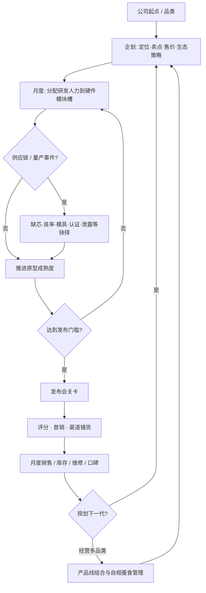

# 《科技公司模拟器》游戏设计文档

> 状态：设计讨论中 · 版本：v0.2（主题转向电子产品）· 最后更新：2026-11-01  
> 开放问题见 [DISCUSSION.md](./DISCUSSION.md)  
> 备注：原「留学模拟器」方向已废弃。

---

## 1. 愿景与定位

### 1.1 产品一句话

《科技公司模拟器》（暂定名；候选见 DISCUSSION：果核 / 键程 / Product Lab / Gadget Corp）是一款**开罗式回合 / 月度经营模拟**：组建团队、研发电子硬件、平衡工业设计与性能成本、搞定供应链与量产、办发布会、卖货并经营生态与口碑——核心体验是「把一款电子产品从概念做到货架」，不是泛泛的公司 Excel。

### 1.2 目标体验

| 关键词 | 含义 |
|--------|------|
| 短循环上瘾 | 企划 → 研发 → 量产 → 发布 → 销售 → 下一代，一季一爽 |
| 权衡有痛感 | 体验 ↔ 成本 ↔ 出货时间，没有全满分 |
| 供应链戏剧 | 一张缺芯 / 良率事件能改写整季计划 |
| 轻幽默科技感 | 吐槽发布会话术与舆情，不山寨真实商标外观 |

### 1.3 受众

- 喜欢开罗《游戏发展国》、Game Dev Tycoon 等短循环经营的玩家
- 对消费电子、发布会、供应链八卦有兴趣的人
- **非目标**：硬核 ERP/财务模拟党、开放世界探索党、纯视觉小说党

### 1.4 核心创意卖点

1. **BOM 三角权衡**：体验 ↔ 成本 ↔ 出货时间，逼玩家做取舍  
2. **供应链戏剧性**：比「写代码进度条」更开罗——缺货、良率、模具、认证会改剧本  
3. **生态与自相蚕食**：新品太强砸旧库存；封闭生态提留存也提骂名  
4. **发布会作为关卡**：话术、Demo 风险、惊喜彩蛋 vs 务实参数  
5. **人才与组织电子化**：工业设计、硬件 PM、射频、供应链、公关等岗位组合

---

## 2. 为何是开罗式（及主题差异）

### 2.1 对标开罗《游戏发展国》的手感

- 短循环、岗位人才、**企划 → 开发 → 评价 → 销售**节奏清晰、易上瘾
- 紧凑 UI 经营 + 关键事件，不做开放世界或纯视觉小说
- 第一版目标：同样的「再开一局改策略」冲动，题材换成电子产品

### 2.2 换成电子产品后要强化的差异

| 发展国侧（软件向） | 本作强化（硬件向） |
|--------------------|--------------------|
| 题材 × 方向加点 | 硬件模块槽：芯片/屏/影像/ID/续航/系统/配件 |
| 主要是工期与评价 | **BOM、供应商、代工、良率、模具、认证** |
| 发售后销量曲线 | **库存、渠道、退货维修、一代吃掉上一代** |
| 续作 / 系列作 | **生态绑定、配件、服务订阅、设计语言延续** |

### 2.3 明确不做的形式

- 开放世界校园 / 园区漫游  
- 纯视觉小说无经营  
- 完整真实财报级 Excel（可用简化财务，见系统拆解）

---

## 3. 核心玩法循环

### 3.1 闭环步骤

1. **公司与品类**：选起点（车库创业 / 小品牌翻身 / 已有一条产品线）；目标品类：手机、笔记本、平板、手表/耳机、智能家居等  
2. **企划**：定产品概念（旗舰 / 主流 / 极简 / 专业）、目标人群、差异化卖点、售价带；锁定设计语言与是否兼容上一代生态  
3. **研发分配**：有限人力 / 月数砸在芯片·性能、屏幕、影像、工业设计与材质、续航、系统体验、配件生态等槽位  
4. **供应链与量产**：选供应商与代工厂、谈价、赌产能；事件：缺芯、良率翻车、模具延期、认证卡住、泄露  
5. **发布与销售**：发布会完成度、媒体/KOL 评分、首销库存、渠道（直营/电商/运营商）、广告与口碑；月度销量与退货/维修成本  
6. **世代循环**：规划下一代；旧机清库存、以旧换新、服务订阅补毛利；品牌声望与「信仰」值

### 3.2 流程（Mermaid）



### 3.3 一局节奏（示意）

- **教程机**：极简 SKU，学会三角权衡与一次发布会  
- **首款旗舰**：完整供应链 + 舆情 + 首年销售  
- **多品类扩张**：手表/耳机/配件吃生态；处理库存与信仰值  

---

## 4. 系统拆解

### 4.1 研发槽（电子模块向）

类似发展国的「题材 × 方向」，本作改为**模块投入**：

| 模块槽 | 影响 |
|--------|------|
| 芯片 / 性能 | 跑分、发热、成本、供货风险 |
| 屏幕 | 观感评分、成本、良率 |
| 影像 | 媒体话题、Demo 风险 |
| 工业设计与材质 | 信仰值、模具周期、成本 |
| 续航与散热 | 口碑长尾、返修 |
| 系统体验 | 软硬一体评分、生态粘性 |
| 配件 / 生态接口 | 附件收入、封闭/开放策略 |

**设计原则**：加点有收益，但拉高 BOM 或拉长模具/认证时间；全拉满 = 延迟上市或亏本。

### 4.2 供应链与量产

- **供应商档位**：便宜不稳 / 均衡 / 贵但稳；可锁定多年合约换折扣  
- **代工厂**：产能、良率曲线、加急溢价  
- **关键事件池**：缺芯、良率崩、模具延期、认证卡住、运输/关税惊吓、工程样机泄露  
- **库存**：首销赌量；过量积压吃现金流，不足吃口碑与黄牛舆情  

### 4.3 财务（简化，非 Excel 模拟）

- 现金、毛利、固定开销（人力、租金、营销）  
- 单机 BOM 成本 ↔ 售价带 ↔ 渠道扣点  
- 服务订阅（云、音乐、延保）作后周期补毛利手段  
- **不做**完整会计科目；数字服务于决策反馈

### 4.4 品牌、舆情与「信仰」值

- 媒体分、用户分、信仰值（设计语言一致性、生态承诺、售后态度）  
- 泄露：提前烧热度或砸发布惊喜  
- 翻车事件：Demo 死机、虚标参数、维修政策争议  

### 4.5 人才与组织

岗位示例（发展国招人逻辑的电子化）：

- 工业设计师、硬件 PM、结构/射频、影像、系统、供应链经理、公关/发布会制作  

组合影响：某模块研发效率、事件选项质量、发布会完成度。人才有疲劳与挖角事件（可 MVP 简化）。

### 4.6 产品线组合与自相蚕食

- 多 SKU：旗舰吸睛、主流吃量、配件吃生态  
- **自相蚕食**：新品体验碾压旧款 → 旧库存贬值加速；可用以旧换新、降价、停产节奏对冲  
- 生态策略：封闭提留存与骂名；开放降配件毛利但扩用户盘  

### 4.7 发布会关卡

- 会前：Demo 稳定性投入、惊喜彩蛋 vs 参数清单、邀请媒体/KOL 组合  
- 会中：选项影响当周热度与翻车概率  
- 会后：评分结算解锁销售修正 buff/debuff  

---

## 5. 进度结构

```text
公司创建（起点三选一）
   ↓
教程机（学会 BOM 三角 + 一次完整发布）
   ↓
首款旗舰年（供应链高压 + 舆情）
   ↓
多品类 / 配件生态（自相蚕食与订阅毛利）
   ↓
世代循环与品牌结局标签（创新偶像 / 供应链之王 / 库存翻车传说 …）
```

---

## 6. 美术 / 叙事基调

- **视觉**：简洁科技感 UI、模块化图标、轻拟物卡片；避免直接山寨任何真实消费电子商标与标志性外观  
- **文案**：轻幽默，吐槽发布会黑话与供应链玄学；不攻击现实公司或抄袭其广告文案  
- **品牌**：游戏内公司与产品线全部虚构（或玩家命名）

---

## 7. MVP 范围与非目标

### 7.1 MVP 应有

- [ ] 一种起点 + 1～2 个可玩品类（建议：手机 + 一款配件）  
- [ ] 企划 → 模块研发 → 简化供应链 → 发布会 → 数月销售的完整环  
- [ ] BOM 三角（体验/成本/时间）可视化  
- [ ] 供应链事件子集（缺芯、良率、泄露至少各一类）  
- [ ] 基础人才 4～6 岗与招聘  
- [ ] 品牌分 / 简单信仰值  
- [ ] 一代之后能开二代（体现轻微自相蚕食）  
- [ ] 中文文案可玩  

### 7.2 第一版不做

- 开放世界园区  
- 真实商标、真实机模外观复刻  
- 完整全球财报 / 税务模拟  
- 联机对战或实时股市  
- 深度芯片工艺节点科研树（可后置）  
- 全面真实参数数据库  

---

## 8. 参考灵感（机制点到为止）

| 参考 | 借鉴 | 不借鉴 |
|------|------|--------|
| 开罗《游戏发展国》 | 短循环、岗位、企划-开发-评价-销售节奏 | 具体题材表、文案、角色 |
| Game Dev Tycoon | 多层研发与口碑销售的经营感 | 具体事件与数值 |
| 异星工厂等 | 仅「瓶颈与物流」直觉，作供应链隐喻 | 不做成工厂建造主玩法 |
| 现实消费电子业常识 | 量产、认证、渠道、以旧换新等层级抽象 | 不复制任何公司机密或受保护营销内容 |

---

## 9. 开放问题

请到 **[DISCUSSION.md](./DISCUSSION.md)** 逐项拍板；结果回写本节与 MVP 边界。

---

## 附录：术语草案

| 术语 | 含义 |
|------|------|
| BOM | 物料清单成本；影响毛利与体验上限 |
| 三角权衡 | 体验 ↔ 成本 ↔ 出货时间 |
| 信仰值 | 品牌忠诚与设计语言信任的抽象指标 |
| 自相蚕食 | 新品冲击本公司旧库存与销量 |
| 发布会关卡 | 以选项与风险检定形式结算的发布节点 |
