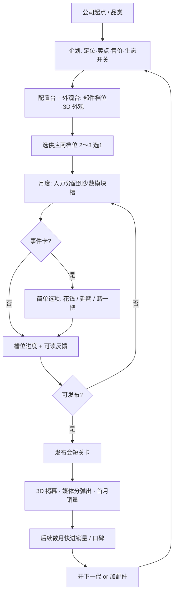

# 《电子产品发展国》游戏设计文档

> 状态：设计讨论中 · 版本：v1.3（信息节奏、44 项行业部件、发布会大秀 §3.10；引导 / 芯片 §3.9）· 最后更新：2026-11-01  
> 开放问题见 [DISCUSSION.md](./DISCUSSION.md)  
> 备注：原「留学模拟器」方向已废弃。

---

## 0. 已决议（写死）

| 项 | 决议 |
|----|------|
| **暂定游戏名** | **《电子产品发展国》**（仓库/工程名仍为 `tech-product-simulator`） |
| **体验手感** | **轻松开罗风**（对标《游戏发展国》短循环），**不是**硬核供应链 / ERP 模拟 |
| 反馈原则 | 短循环、可读反馈、岗位/企划有梗、失败可快速重来 |
| 供应链定位 | **事件卡 + 2～3 档供应商简单选项**；不做深度 BOM 表、精细库存算法、多级物流 |
| 数值友好 | 研发用**少数清晰槽位** + 人才组合；玩家一眼看懂加减 |
| **乐趣支点** | **A 匹配解谜为主 + B 档期/竞品为辅**，团队养成调味（§3.4） |
| **推荐按钮** | **稳但平庸**：保底不破产，拿不到高分 |
| **一局结构** | 正式 10 年；MVP 3 年短局（§3.4.10） |
| **产品 DIY** | 配置台（部件档位）+ 外观台（预设拼装）+ 3D 展示；外观自由表达、部件影响数值（§4.8） |
| **画风** | 像素开罗风办公室 + 像素化 3D 机型展示（§4.8.6） |
| **参数梗** | 虚构跑分 / 虚构部件命名，不对标真实型号 |
| **创新** | 惊艳度 = 新颖度 × 完成度；概念件 + 竞品抄袭；大改 / 小改交替；表达层不计分（§3.5） |
| **主流程** | 竖屏优先；每阶段独立像素场景；部门升级代替招聘；25 个概念件分五层解锁；出圈度（§3.6） |

详见 [DISCUSSION.md Q4](./DISCUSSION.md)（已拍板）。

---

## 1. 愿景与定位

### 1.1 产品一句话

《电子产品发展国》（**已决议暂定名**；英文/工程侧可用仓库名 `tech-product-simulator`）是一款**轻松开罗式回合 / 月度经营**：组建有梗的团队、用少数模块槽研发电子产品、用简单供应商档位与事件卡「过」供应链、办一场爽快的发布会、看媒体分与月销量——核心是「把一款电子产品从概念做到货架」，节奏像发展国，不是公司 Excel。

### 1.2 目标体验（已锁定）

| 关键词 | 含义 |
|--------|------|
| 短循环上瘾 | 企划 → 研发 → 事件 → 发布 → 销售 → 下一代，一局想再开 |
| 可读反馈 | 槽位、评分、销量用大数字与短评，少隐藏公式 |
| 权衡有痛感但不折磨 | 体验 ↔ 成本 ↔ 出货时间三角存在，但选项清晰 |
| 供应链是戏剧不是作业 | 缺芯/良率用**一张事件卡**改剧本，不填表 |
| 发布与销量要爽、要快 | 媒体分弹出、月销量曲线一眼懂 |
| 轻幽默科技感 | 岗位与企划有梗；不山寨真实商标外观 |

### 1.3 受众

- 喜欢开罗《游戏发展国》、Game Dev Tycoon 等短循环经营的玩家
- 对消费电子、发布会八卦有兴趣、但不想学 ERP 的人
- **非目标**：硬核供应链/财务模拟党、开放世界探索党、纯视觉小说党

### 1.4 核心创意卖点

1. **轻量三角权衡**：体验 ↔ 成本 ↔ 出货时间（抽象成本条即可，不做精细 BOM 行项目）  
2. **供应链戏剧性（事件向）**：缺货、良率、泄露用事件卡推动，保留开罗式「糟了！」瞬间  
3. **生态与自相蚕食（简化）**：新品太强砸旧款销量；封闭/开放点一下有后果  
4. **发布会关卡要爽**：短选项、Demo 风险、彩蛋 vs 务实，立刻出媒体分  
5. **人才有梗**：工业设计、硬件 PM、射频、供应链、公关等岗位组合，招人像发展国

---

## 2. 为何是轻松开罗式（及主题差异）

### 2.1 手感锚点：开罗《游戏发展国》

- 短循环、岗位人才、**企划 → 开发 → 评价 → 销售**清晰上瘾  
- 紧凑 UI + 关键事件；失败重开成本低  
- **已决议**：深度对标此手感，供应链只作题材调味，不升级成模拟经营硬核盘

### 2.2 电子产品题材差异（仍保持轻松）

| 发展国侧 | 本作（轻松版） |
|----------|----------------|
| 题材 × 方向加点 | **少数**硬件模块槽 + 人才加成 |
| 工期与评价 | 抽象「成本条 / 风险条」+ 事件卡（缺芯、良率、认证、泄露） |
| 发售后销量 | **快反馈**媒体分 + 月销量；库存用简单「备货偏多/偏少」档，不做精细算法 |
| 续作 | 下一代 + 轻微自相蚕食；配件/生态用开关与少量数值 |

### 2.3 明确不做的形式

- 开放世界园区漫游、纯视觉小说  
- 硬核供应链、精细 BOM 表、多级库存/物流 ERP  
- 完整财报、真实芯片制程节点树、实时股价盘  

---

## 3. 核心玩法循环

### 3.1 闭环步骤（轻松版）

1. **公司与品类**：选起点（车库 / 小品牌 / 已有产品线）；品类先手机，再加一配件  
2. **企划**：定位（旗舰/主流/极简/专业）、卖点标签、售价带、是否绑上代生态——选项有梗、少填空  
   - **配置台 + 外观台**：选部件档位、拼外观，3D 实时看厚度/镜头模组/质感（§4.8）  
3. **研发分配**：每月把人力丢进**少数清晰槽位**（见 4.1）；人才决定效率与彩蛋  
4. **供应链（薄）**：开研发前或中段选 **2～3 档供应商**；过程中抽**事件卡**（缺芯、良率、模具、认证、泄露）做简单选项  
5. **发布与销售（爽快）**：短发布会关卡 → 立刻媒体分/用户分 → 数个月销量与口碑，节奏快  
6. **世代循环**：开下一代；旧款用「清仓 / 以旧换新 / 不管」等简单策略；信仰值轻量累积

### 3.2 流程（Mermaid）



### 3.3 一局节奏

- **教程机**：一个机型、一次供应商选择、一张事件、一场发布会——教会三角与爽感  
- **首款旗舰年**：多几个事件 + 舆情梗，仍然短  
- **配件 / 二代**：教生态开关与轻微自相蚕食，不引入复杂库存系统  

### 3.4 核心决策模型（v0.6 新增，已拍板方向）

> **为什么要这一节**：v0.5 只写了「有哪些系统」，没写「玩家凭什么做出有意思的选择」。原型试算暴露出：研发怎么分都差不多（体验分取槽位平均）、高价带碾压、延期几乎无代价、发布会有固定最优解。本节定义**决策从哪来、数值往哪个方向走**；具体系数在原型里调。

#### 3.4.1 乐趣支点（已拍板）

| 支点 | 权重 | 一句话 |
|------|------|--------|
| **A. 匹配解谜** | 主 | 定位 × 卖点 × 研发配比要「对上」——像发展国摸索类型配比，靠反馈学会 |
| **B. 档期与竞品** | 辅 | 有档期窗口和虚构竞品，「时间」变成真代价，延期要权衡 |
| C. 团队养成 | 调味 | 员工升星、办公室扩建，给长期目标但不抢主线 |

设计护栏：**每个决策都要有「看得见的代价」和「下一代能学会的反馈」**；没有永远最优的选项。

#### 3.4.2 需求匹配（A 支点核心）

**定位理想配比**（5 槽占比，合计 100%；首次游玩隐藏，靠反馈解锁）：

| 定位 | 性能 | 屏幕与外观 | 影像 | 续航与稳定 | 系统与生态 |
|------|------|------------|------|------------|------------|
| 旗舰 | 25 | 20 | 30 | 10 | 15 |
| 主流 | 20 | 20 | 20 | 25 | 15 |
| 极简 | 10 | 35 | 10 | 30 | 15 |
| 专业 | 30 | 10 | 35 | 15 | 10 |

（数值为初稿，原则：每个定位有 1～2 个「主槽」，平均分配只能拿中等匹配。）

- **体验分 = 研发量 × 匹配度 × 供应商品质**  
  - 研发量：各槽进度之和（受人才加成、技术上限影响）  
  - 匹配度：实际配比与理想配比的距离，`1 − ½·Σ|实际% − 理想%|`，映射为 **×0.7 ～ ×1.15**  
  - 平均分配 ≈ ×0.9；贴近理想 ≈ ×1.1 以上  
- **卖点 = 承诺**：每个卖点绑定一个槽（性能猛兽→性能、影像叙事→影像、极致轻薄→外观、续航焦虑终结者→续航、生态闭环→系统且需绑生态、性价比刺客→亲民价带）。  
  - 该槽占比达标 → 卖点兑现，媒体/用户分加成  
  - 不达标 → 「货不对板」，用户分扣分 + 短评吐槽  
- **可学性**：发布后给「配比雷达」，逐槽短评「多了 / 少了 / 刚好」（如「旗舰的影像有点拉胯」）；某定位首次拿到高匹配，就把它的理想配比写进**企划笔记**，以后企划时可见——知识本身就是成长。

#### 3.4.3 价格 × 定位 × 销量（去掉高价碾压）

- 每个定位有**合理价带**：旗舰/专业→旗舰带，主流→主流带，极简→亲民或主流。  
- 价高于合理带：用户分 −、短评「贵得离谱」；价低于合理带：利润薄、口碑 +。  
- 单台毛利 = 售价 − 单台成本（定位成本 × 供应商系数）；**需求随价格显著下降**。  
- 平衡目标：定位与价带匹配时，三档价带的**期望总利润相差在 ±15% 以内**，差异体现在风险和口碑上，而不是绝对收益。

#### 3.4.4 档期、趋势与竞品（B 支点）

- **年历**：一年 12 月。档期窗口（虚构化命名，如「开学季」「年货季」「双十一式购物节」）首月需求 ×1.3；淡季 ×0.8。  
- **企划时选目标发售月**；研发拖延错过档期，在事件 / 延期选项上**直接显示后果**（「将错过购物节，首月需求 −25%」）。  
- **年度趋势**：每年年初新闻公布 1～2 个热门卖点；命中趋势 → 期待值 +。趋势逐年轮换，偶尔有「行业报告」预告下一年。  
- **虚构竞品**：MVP 1～2 家 AI 品牌，各有发布节奏与主打（例：「蓝莓科技 9 月发旗舰，主打影像」），**提前放出传闻**。同月同定位撞车 → 按相对体验分瓜分需求。玩家可以选择避开或正面硬刚。

#### 3.4.5 期望线（每一代都要更好）

- **媒体分是相对分**：`媒体分 ≈ 50 + k·(本代体验 − 期望基准) + 发布会修正 + 趋势修正`  
- 期望基准 = max(上一代体验，同定位竞品) × 0.9 + 年份通胀（每年 +3 左右）。  
- 原地踏步 = 分数下滑，媒体分屏幕上显示期望线，**分数高低的原因一眼可见**。  
- 对应的追赶手段见 3.4.6 的成长线。

#### 3.4.6 局内成长（C 调味）

- **技术等级**：每次发布按体验分获得技术点，用来**解锁更高档部件**（部件档位决定槽位上限，见 §4.8.2）——用于追上期望线。  
- **员工升星**：参与一代研发获得经验，满经验升星（≤5 星），星级提高槽位加成。疲劳/挖角后置。  
- **办公室扩建**：花现金加工位 = 人力点上限 +1～2，带像素办公室视觉变化。  
- 配件品类、第二起点等仍为二期解锁项。

#### 3.4.7 销售长尾与自相蚕食（补规则）

- 销量按月衰减（约 ×0.7/月），**开发下一代时旧款继续在售**（像发展国边做边卖），最长 6 个月或停产。  
- 新品上市时，同定位旧款销量 ×0.5，不同定位 ×0.85。玩家三选一：**降价清仓**（一次性回款、利润低）/ **以旧换新**（花钱，信仰 + 且新品销量 +10%）/ **停产**。  
- 备货：没卖完的货可以在长尾月份继续卖，但每月扣仓储费——激进备货不再是纯亏。

#### 3.4.8 事件与发布会：跟局势挂钩

- **事件代价随局势变化**：加钱插队的金额随定位成本上升；延期的代价随档期显示；现金紧的时候「花钱」选项高亮风险。MVP 事件池扩到 **6～8 张**，部分事件跟供应商档位、趋势、竞品有关。  
- **发布会风格 × 卖点**：参数轰炸 ↔ 性能 / 续航；惊喜彩蛋 ↔ 影像 / 轻薄；稳妥发布 ↔ 任何卖点（中等分）。风格匹配才是最优解。  
- **翻车率与产品挂钩**：Demo 死机率由「续航与稳定」「系统与生态」进度决定，不是固定概率。

#### 3.4.9 「推荐」按钮的定位（已拍板）

- 推荐 = **稳但平庸**：保证不破产，媒体分约 60～70，拿不到高分称号与结局。  
- 推荐**不读**隐藏理想配比；一键均衡 = 平均分配（匹配度中等）。  
- 已写进企划笔记的配比，推荐才会采用——玩家学到的东西会反哺推荐，休闲玩家也能感到进步。

#### 3.4.10 一局结构（默认）

- **正式版**：10 年一局，年末结算，局末按指标给结局称号（创新偶像 / 发布会之神 / 仓库传说 / 性价比之王 …），可继续无尽模式。  
- **MVP**：**3 年短局**（36 个月，约 4～6 代，目标 20～40 分钟），验证「匹配 + 档期 + 期望线」是否让第二、三代有新的决策。

#### 3.4.11 数值验证清单（原型自测用）

- [ ] 同样的研发量，贴近理想配比 vs 平均分配，体验分差 ≥ 15%  
- [ ] 不存在全局最优的价带 / 发布会风格 / 供应商（每个都有赢的局面）  
- [ ] 错过档期的代价 ≥ 延期一个月的工资 × 3  
- [ ] 连续 3 代不升级技术、不调整配比，媒体分明显下滑  
- [ ] 全程点推荐：不破产，但拿不到 80+ 媒体分  

### 3.5 创新、创意表达与节奏（v0.8 新增，已拍板）

> **主题**：现实里的大公司越来越会「挤牙膏」，这款游戏让玩家替它们做出惊艳的产品。创意是核心卖点，但必须服务于循环与节奏——不让创意变成装饰，不让系统评判审美，也不让创作拖垮一局的节奏。

#### 3.5.1 三个要避开的坑

| 坑 | 表现 | 对策 |
|----|------|------|
| 创意只是装饰 | 颜色随便调，和输赢无关，几局后没人在乎 | 创新层直接决定「惊艳度」，进媒体分与世代循环 |
| 系统给审美打分 | 玩家猜公式、追最优解，反而不敢创新 | 只算「新不新」与「做没做好」，**从不判断好不好看**；去掉「追流行加分」 |
| 创作环节太重 | 每代捏十分钟，20～40 分钟节奏崩掉 | 创作时间前置且可选；大改 / 小改交替；处处有默认方案 |

#### 3.5.2 创意三层

| 层 | 内容 | 计分 |
|----|------|------|
| **表达层** | 配色、拼色、命名、镜头布局样式、圆角 | **不计分**；沉淀为品牌辨识度、设计语言（信仰）与机型馆收藏 |
| **取舍层** | 部件档位（§4.8.2） | 影响上限、成本、形体；**少见的配置组合**算「品类创新」（如小屏旗舰） |
| **创新层** | **概念件**（§3.5.4） | 新颖度主要来源；有研发、成本、良率风险 |

#### 3.5.3 惊艳度 = 新颖度 × 完成度

- **新颖度（0～100）**：与「市场记忆」比较——你和竞品近两年发布过的所有产品。  
  - 概念件：市场首发 +25；竞品已有 +10；已经烂大街 +3  
  - 品类创新组合：首发 +12；已有人做 +4  
  - 与上一代几乎一样 → 媒体标题「又是挤牙膏的一年」  
- **完成度（0～100%）**：正式游戏里 = 研发进度 × 稳定度；新工艺首发有良率 / 翻车风险，第二代打磨后成熟。  
- **惊艳度 = 新颖度 × 完成度**，决定媒体分加成与头条：  
  - 新且好 →「这才叫创新！」  
  - 新但糙 →「概念满分，做工翻车」  
  - 好但旧 →「稳，但又是挤牙膏」  
- **市场两段反应**（创新扩散）：首发拿媒体与尝鲜用户；大众销量要等下一代把它做成熟——一个创意自然跨两三代展开。

#### 3.5.4 概念件（MVP 6～8 个，全部虚构化表述）

| 概念件 | 外观可见 | 代价 / 风险 | 搭配梗 |
|--------|----------|-------------|--------|
| 透明后盖 | 能看见内部元件 | 成本 +、外观上限 −（内部要好看） | 配旗舰芯片的铜色均热板更帅 |
| 背部副屏 | 背面小彩屏 | 厚度 +、续航 − | 自拍取景、通知梗 |
| 墨水背屏 | 整块墨水屏背面 | 成本 +、与透明后盖互斥 | 续航党狂喜 |
| 灯效后盖 | 会呼吸的灯带 | 续航小 − | 发布会关灯时最出彩 |
| 实体键盘 | 正面下半是键盘 | 屏幕变小、影像 / 外观上限 − | 极简 / 专业定位加成 |
| 机械快门键 | 侧边橙色快门 | 成本小 + | 影像卖点加成 |
| 卫星天线 | 顶部翻折小天线 | 成本 + | 户外梗 |
| 主动散热风扇 | 背面转动的风扇 | 厚度 +、重量 + | 配 S5 才不是「吹空气」 |

规则：每代最多 2 个概念件（大改款）；概念件之间有互斥与加成；首发概念件完成度 −12%，第二代 −5%，第三代起成熟。

#### 3.5.5 竞品会抄你

- 2～3 家虚构竞品，各自有产品记忆（MVP 先做静态列表 + 抄袭规则）。  
- 你首发的概念件，在 1～2 代后被竞品抄走 → 该概念的新颖度衰减。  
- 被抄 = 荣誉：机型馆记录「首创 ×N / 被 M 家跟进」，计入品牌与结局称号（如「潮流定义者」）。  
- 年度新闻改为「竞品今年扎堆：……」——告诉玩家哪里已经红海，而不是「流行什么就跟什么」。

#### 3.5.6 节奏：大改款 / 小改款交替

| | 小改款 | 大改款 |
|---|--------|--------|
| 可改 | 配色、部件档位 | 全部：尺寸、圆角、屏幕形态、镜头布局、概念件 |
| 代价 | 无 | 模具费（单台成本 + / 一次性现金）、工期 +1 月、完成度 −5% |
| 作用 | 快、稳、靠打磨提升完成度 | 新颖度的主要窗口 |

- 首代必定是大改款（新品）。  
- 玩家自然形成「两三代一次大创作」的节奏，系统不强制。  
- 连续小改 3 代 → 媒体开始用「挤牙膏」吐槽（新颖度惩罚），推动下一次大改。

#### 3.5.7 一代的时间预算（目标 5～7 分钟）

| 环节 | 时长 | 情绪 |
|------|------|------|
| 企划 + 配置台 | ~60 秒 | 创作高峰 |
| 外观 + 创新 | 大改 60～90 秒；小改 ~20 秒 | 表达 |
| 月度研发 + 事件 | ~2 分钟 | 经营紧张 |
| 发布会 | 完整 ~5 秒；之后可跳过或 1.5 秒快速版（高分 / 首发概念时自动给完整版） | 高潮回报 |
| 销售 + 机型馆 | ~30 秒 | 复盘 |

护栏：任何创作环节都有默认方案，永远不卡进度；大创作只在大改款出现，避免创作疲劳。

#### 3.5.8 与既有设计的关系

- §3.4.2 的「需求匹配」照旧决定**体验分**（研发做得对不对）；本节的「惊艳度」决定**话题与媒体加成**（做得新不新）。二者相乘进入媒体分。  
- §4.8.4 外观计分中的「趋势命中加分」**取消**；「材质 × 定位」「厚重超标」保留在体验 / 用户分侧；「设计语言连贯」只影响信仰，不计入惊艳度。  

### 3.6 主流程呈现、部门与脑洞概念（v0.9 新增，已拍板）

> 目标：主流程每个阶段都有自己的场景与状态，竖屏手机友好；玩家只负责方向，不管细节；创意上限交给越来越夸张、越来越有传播力的概念件。

#### 3.6.1 一代的流程与场景

| 阶段 | 场景（像素，随状态变化） | 玩家决定 |
|------|--------------------------|----------|
| 📋 企划 | 会议室：白板便签随定位 / 卖点 / 价带变化，大家头上冒点子气泡 | 定位、卖点、售价带、生态 |
| 🎨 设计 | 3D 设计部（配置 / 创新 / 外观） | 部件、概念件、外观、大改 / 小改 |
| 🤝 供应 | 供应商码头：三个摊位（破帐篷 / 规整摊 / 玻璃展台），选中的打聚光；备货堆随档位变高 | 供应商、首批备货 |
| 🔬 研发 | 实验室：5 个工位对应 5 个研发槽，头顶进度条 + 上限红线；推进时火花与 +N；事故时变体（缺芯红灯、良率冒烟、谍照闪光、铰链断裂） | 推进 / 一直推进、⭐ 重点槽 |
| 🏭 量产 | 工厂：流水线上的手机就是你设计的颜色，机械臂冲压火花，打包堆随备货量增长 | （约 4.5 秒的节奏停顿） |
| 🎤 发布 | 后台：幕布、扫动光柱、观众举手机 → 选讲法 → 全屏 3D 揭幕 | 稳妥 / 彩蛋 / 参数 |
| 📰 评分 | 舞台定格：大屏打出等级，翻车时冒烟 | — |
| 🛒 销售 | 门店：缺货→长队 + 黄牛；正常→适度排队 + 拎袋出门；积压→冷清 + 店里堆箱子 | — |
| 🏛 下一代 | 年会：机型墙（历代机型 + 等级 + 首创奖杯） | 部门升级 |

#### 3.6.2 竖屏布局

HUD（公司 / 代数 / 资金 / 信仰 / 口碑 / 研发点）→ 阶段进度条 → 场景 → 操作面板 → 吸底主按钮。每个阶段只有一个主按钮，次要操作收在面板里；设计阶段切换到 3D 工作台，发布会全屏。

#### 3.6.3 部门代替招聘

| 部门 | Lv1 → Lv3 |
|------|-----------|
| 🎨 设计部 | 每代可用概念件 1 → 3；外观研发加速 |
| 🔬 研发部 | 每月人力 6 → 10；研发点加成 |
| 🏭 供应链 | 事故率 ×1 → ×0.6；Lv3 成本 −5% |
| 📣 公关部 | 发布会 +3 → +11；出圈度 ×1 → ×1.4 |

升级只在「规划下一代」时进行，是一代结束后的大方向决策。

#### 3.6.4 脑洞概念件：五层解锁

| 层级 | 解锁 | 概念件 |
|------|------|--------|
| T1 车库脑洞 | 开局 | 灯效后盖、机械快门键、实体键盘、透明后盖、背部副屏 |
| T2 工程魔改 | 5 研发点 | 墨水背屏、散热风扇、卫星天线、升降镜头、可换电池、内置手写笔 |
| T3 形态实验 | 12 研发点 | 滑盖、旋转屏、折叠屏、模块化背板、太阳能背板、变色后盖 |
| T4 未来原型 | 20 研发点 + 前置 | 三折叠（需发过折叠屏）、环绕屏（需副屏或折叠）、卷轴屏（需折叠或滑盖）、全透明机身（需透明后盖）、机械表芯后盖、投影仪 |
| T5 科幻彩蛋 | 30 研发点 + 前置 | 全息投影（需投影仪）、电子宠物背屏（需副屏或墨水屏） |

- 每个概念件在 3D 上都有可见形态，形态类会动（折叠开合、三折 Z 字、卷轴卷出、滑盖露出手柄层、旋转成 T 字、升降镜头、表芯齿轮转动……）。
- 研发点来自每次发布：保底 2 + 媒体分 + 惊艳度 + 首发数 + 研发部等级。
- 越高层越新颖（首发 26 → 45）、风险越大（首发完成度 −4 → −26），**出圈度**也越高。

#### 3.6.5 出圈度（用户自发传播）

- 概念件自带出圈值（🔥），首发 ×1.6、独家 ×1.1、被抄后 ×0.6；公关部再放大。
- 出圈度提升话题（hype）与首月需求；≥40 触发「#机型名# 冲上热搜」。
- **做工翻车但出圈**是一条合法路线：完成度低但出圈高时，标题是「做工翻车，但全网都在讨论」，仍然能卖。

### 3.7 V4 数值落地（v1.0，原型已实现）

> 对应 §3.4 的设计，已在 `src/game/market.js` + `src/game/logic.js` 实现，并用无界面模拟（5 个随机种子 × 3 年）校准。

| 规则 | 实现 |
|------|------|
| 理想配比 | 4 个定位各一套 5 槽理想占比；匹配度 = 1 − Σ|实际% − 理想%| / 100 → 体验 ×0.7～×1.15 |
| 团队直觉 / 企划笔记 | 自动分配默认半程贴近理想配比；某定位匹配度 ≥85% 时记入企划笔记，之后完全贴近 |
| 研发节奏 | 默认做满工期；完成度 ≥60% 可「🚀 提前量产」抢档期（完成度换时间） |
| 卖点承诺 | 卖点绑定槽位或形体（如极致轻薄 ≤7.8mm）；兑现用户 +3，「货不对板」−6 |
| 价格 × 定位 | 合理价带：旗舰 / 专业→旗舰带，主流→主流带，极简→亲民或主流；贵一档用户 −6，便宜一档 +2 但利润薄 |
| 单台利润 | (售价 − 部件成本) / 1000 × 2；需求：亲民 ×2.2 / 主流 ×1 / 旗舰 ×0.55 |
| 档期 | 年货季 ×1.2、开学季 ×1.25、购物节 ×1.35、淡季 ×0.8（按上市月份） |
| 竞品撞档 | 3 家竞品按排期发布；同定位 ±1 月撞档 → 需求按媒体分对比瓜分（×0.6～×1.15） |
| 期望线 | max(42 + 年 × 4, 上一代体验 × 0.95)；媒体分 += (体验 − 期望线) × 0.35 |
| 创新回报 | 需求 × (0.82 + 惊艳度 / 140) × (1 + 出圈度 / 60)；创新产品更容易缺货 → 备货提示 |
| 3 年结局 | 第 36 个月结算称号：潮流定义者 / 惊艳制造机 / 出圈狂魔 / 仓库传说 / 印钞机 / 挤牙膏之王 / 稳健经营者 |

**模拟结果（3 年、推荐打法）**：主流推荐、旗舰高价、极简亲民、主流 + 创新都能活下来，现金约 90～650；旗舰卖亲民价（错配）会破产。创新路线需求最高，但不配合激进备货会卖断货。

### 3.8 长尾、扩建与分享（v1.1，原型已实现）

**销售长尾与自相蚕食**
- 每代上市后进入「在售」：之后每月继续卖，月销约为首月的 30%（受用户分与惊艳度影响），每月 ×0.6 衰减，最长 6 个月；研发期间每月自动入账。
- 新品上市前（量产阶段）对旧款三选一：**继续卖**（同定位旧款 ×0.5、其他 ×0.85）/ **降价清仓**（一次性回款约 5 成，口碑 −1）/ **以旧换新**（花 10，信仰 +3，新品首月需求 +12%）。

**办公室扩建**（规划下一代时）

| 等级 | 费用 | 效果 | 场景 |
|------|------|------|------|
| 🏚 车库 | — | — | 木板墙、吊灯泡、纸箱 |
| 🏢 小办公室 | 60 | 人力 +1 | 会议室 + 窗外城市 |
| 🏙 写字楼 | 150 | 人力 +2 · 发布会 +4 · 研发点 +1 | 落地窗、高楼、奖杯架、实验室服务器墙 |
| 🌳 科技园 | 300 | 人力 +3 · 发布会 +7 · 研发点 +2 | 绿植、霓虹招牌、巡逻机器狗、实验室无人机 |

扩建会多付月薪（+2 / +5 / +8），扩建当下切到「总部外景」场景庆祝。

**分享卡**（用户自发传播）
- 发布会后与三年结局各有一张 720×1280 竖版卡：3D 机型截图、评级章、惊艳 / 新颖 / 完成 / 出圈、首发徽章、热搜话题、头条；结局卡含称号与历代机型墙。
- 配一段可复制的文案；支持保存图片与系统分享（环境允许时）。

**模拟（3 年、5 个随机种子）**：主流推荐 ≈ 570、旗舰高价 ≈ 710、主流 + 创新（激进备货、升级设计部）≈ 460、极简亲民 ≈ 115、一路扩建到写字楼 ≈ 330；旗舰卖亲民价仍会破产。

### 3.9 新手引导、自研芯片、发布会加戏（v1.2，原型已实现）

**新手引导**：第一局每个阶段第一次出现时，导师「老周」弹出一张引导卡（共 10 张：企划 / 设计 / 供应链 / 研发 / 事件 / 量产 / 发布会 / 评分 / 销量 / 下一代），随时可「跳过全部引导」。

**自研芯片线**
- 开局给芯片系列起名（≤4 字，如「玄鸟」）；芯片按「系列 X代 + 标准 / Pro / Max」命名。
- 每一代：跑分约 +28%，性能上限 +5（Max 档封顶 100）；配置页显示三档与竞品同期芯片的跑分对比条。
- 规划下一代时在「芯片实验室」流片：花费 30 + 代数 × 20，耗时 3 个月（研发部 Lv3 为 2 个月），在下一代研发期间并行完成，再下一代可用；实验室显示历代跑分走势与竞品对比柱状图。
- 首发新一代芯片：新颖度 +8。

**3D 展示**：只保留高清档（抗锯齿 + 渐变聚光背景），不再显示像素档位。

**发布会加戏**（完整版）：揭幕 →「今天，我们带来——」→ 芯片跑分对比（大屏柱状图，超过竞品时观众欢呼）→ 翻车时大屏雪花「ERROR」+ 现场笑声 → 有首发时「ONE MORE THING…」→ 首发概念揭晓（转到背面 + 火花）→ 价格揭晓（观众按定价是否合理反应）。全程有字幕和观众反应气泡，可跳过。快速版只保留价格揭晓。

**评论区**：弹幕放慢（11 秒横穿）；评分页新增常驻评论区，按点赞排序，包含货不对板、定价吐槽、翻车名场面、热搜等情境评论。

### 3.10 信息节奏、行业部件与发布会大秀（v1.3，原型已实现）

**信息节奏原则**
- 界面上只露出带虚线的术语，点开才有一句话解释（`src/glossary.js`）；只讲「是什么」，不公布公式和倍率。
- 隐藏的数值：配比匹配度与倍率、事故率、翻车率、档期需求倍率、话题加成、评分加减明细。保留的：价格、成本、厚度、重量、跑分、现金、媒体 / 用户评分等「看得见的事实」。
- 设计台的「市场预判」改为定性：新颖度 ★、工艺风险 低 / 中 / 高、出圈度 🔥。
- 新手引导只讲「做什么」，不讲公式。

**行业部件：44 项，分五类逐步出现**
- 分类：📷 影像 / 📱 屏幕与形态 / 🔋 续航与充电 / 💎 机身与材质 / 🧪 交互与黑科技。
- 新增 19 项行业部件：潜望长焦、一英寸大底、微云台、屏下摄像头、百瓦快充、硅碳电池、磁吸无线充、无线反充、钛金属中框、陶瓷后盖、IP68、3.5mm 耳机孔、红外遥控、存储卡槽、超大线性马达、超声波指纹、3D 结构光、类纸护眼屏、防窥屏、端侧 AI 芯片。
- 出现时机：第 1 代 6 项 → 第 2 代 +8 → 第 3 代 +15 → 第 14～24 个月逐步出现形态类与高阶部件 → 发布过前置部件后出现三折叠、环绕屏等；端侧 AI 需芯片到第 3 代。
- 新部件出现时，企划页弹出「📰 行业新技术」快讯，创新页对应卡片带 NEW；没出现的部件完全不显示，只提示「还有 N 项技术尚未出现」。

**发布会大秀**（完整版约 25 秒，可跳过）
倒计时 3-2-1 → 新机升起 →「今天，我们带来——」→ 章节 01 外观（配色、厚度）→ 02 芯片（跑分对比）→ 03 影像（夜景样张，影像越强噪点越少）→ 04 续航（电池格）→ 随机现场事件（神秘嘉宾 / 观众要手机 / 主讲人口误 / 粉丝应援）→ 翻车时 ERROR → ONE MORE THING → 每个首发部件单独揭晓 + 烟花 → 价格（先报划线原价，再揭晓早鸟价）→ 今晚 20:00 开售倒计时 → 谢幕烟花。全程有字幕、观众反应气泡和「现场热度」计。快速版只保留外观、价格与开售。

---

## 4. 系统拆解（按轻松开罗收紧）

### 4.1 研发槽：少数清晰槽位

MVP **建议 5 槽**（可合并，避免七七八八记不住）：

| 槽位 | 玩家能看懂的反馈 |
|------|------------------|
| 性能 | 跑分感 / 「快不快」短评 |
| 屏幕与外观（ID） | 好看分、信仰感 |
| 影像 | 发布会话题、Demo 翻车率 |
| 续航与稳定 | 口碑长尾、返修抱怨 |
| 系统与生态 | 软硬一体分、配件加成 |

人才站在槽上 = 加速或触发趣味事件。  
**各槽怎么分配才算好**由定位理想配比决定（§3.4.2），平均分配只拿中等分。  
**成本 / 时间**用两条总表进度（或一个「量产压力」条）汇总，**不**让玩家填 BOM 明细。

### 4.2 供应链：档位 + 事件卡（已锁定薄实现）

- **供应商**：约三档——便宜不稳 / 均衡 / 贵但稳；选一次，影响事件频率与成本条  
- **事件卡**：缺芯、良率糟了、模具延期、认证卡住、样机泄露等；每张 2～3 个选项（加钱、延期、降规格、赌）  
- **备货**：发布前选「保守 / 正常 / 激进」一档即可；结果用销量月报里的短句反馈（缺货黄牛 / 仓库吃灰）  
- **MVP 不做**：多级 BOM、良率曲线编辑、合约年限模拟、精细 SKU 库存算法、关税物流表  

### 4.3 财务（极简）

- 只保留：现金、每机抽象成本、售价、本月盈亏大字  
- 服务订阅可做后期一个开关（+小额月入）  
- **排除**：精细科目、税务、全球财报  

### 4.4 品牌、舆情、信仰值

- 媒体分、用户分大字弹出；信仰值缓慢涨跌  
- 泄露 / 翻车用事件或发布会选项触发，文案有梗  

### 4.5 人才与组织（v0.9 起由「部门」代替，见 §3.6.3）

- 岗位示例：工业设计、硬件 PM、影像、系统、供应链、公关  
- 招聘界面像发展国：看星级与一句性格梗  
- 组合影响槽位速度与发布会稳定度；疲劳/挖角可极简或后置  

### 4.6 产品线与自相蚕食（轻）

- 二代或配件上市时，旧款销量自动打折扣（具体规则见 §3.4.7）  
- 玩家用「降价清仓 / 以旧换新活动 / 停产」三选一应付  
- 生态：封闭 / 开放一个开关，影响配件收入与骂名事件率  

### 4.7 发布会与销售反馈（要爽、要快）

- **会前**：少量准备选项（Demo 加稳、加彩蛋、加参数稿）  
- **会中**：2～4 个节点选项，立刻反馈「全场欢呼 / 冷场 / 死机」  
- **会后**：媒体分（相对期望线，§3.4.5）、用户期待条、首月销量预估 **同一屏结算**  
- 风格要和卖点匹配，翻车率由产品稳定度决定（§3.4.8）  
- **月销量**：数月快进或一键看完曲线，少点确认  

### 4.8 产品 DIY 与展示（v0.7 新增，已拍板）

> 目标：让玩家**亲手配出、亲眼欣赏**自己的机型。游戏发展国做完只能看分，本作能把产品「摸到手里」——这是题材独有的乐趣。

#### 4.8.1 原则：外观自由表达，部件影响数值

| 层 | 内容 | 影响数值？ |
|----|------|-----------|
| **审美层** | 配色、双色拼接、后盖文字、镜头布局样式 | **基本不影响**（仅命中年度流行色/样式有小加成）——玩家放心按喜好做，不会被判「审美错误」 |
| **部件层** | 芯片、屏幕、主摄、电池、机身材质、机身尺寸 | **影响**：决定各研发槽**上限**、单台成本、厚度/重量，并且**在 3D 上看得见** |

与 §3.4 的分工：**配置台定上限、成本与形体 → 研发分配决定做到多少 → 匹配度决定体验分**。

#### 4.8.2 配置台：部件档位（每件 3 档，虚构命名）

| 部件 | 档位示例（虚构） | 研发槽上限 | 3D 可见后果 | 其他 |
|------|------------------|-----------|-------------|------|
| 芯片 | 蜂鸟 S1 / S3 / S5 | 性能 60 / 80 / 100 | —（跑分数字跳动） | 高档发热 → 续航与稳定 −；成本 + |
| 屏幕 | 普通屏 / 高刷屏 / 旗舰屏 | 屏幕与外观 +0 / +10 / +20，系统流畅感 + | 边框变窄 | 成本 + |
| 主摄 | 单摄 / 双摄 / 大底三摄 | 影像 60 / 80 / 100 | **镜头模组变大、更凸** | 重量 +、成本 + |
| 电池 | 小 / 中 / 大 | 续航 60 / 80 / 100 | **机身变厚** | 与「极致轻薄」卖点冲突 |
| 机身材质 | 塑料 / 玻璃 / 金属（+ 素皮彩蛋） | 屏幕与外观 60 / 80 / 100 | 质感与反光 | 重量、成本、材质 × 定位匹配 |
| 机身尺寸 | 小 / 标准 / 大 | 大屏影像/续航 +，轻薄 − | 整机缩放 | 重量 |

- **实时读数**：厚度、重量、虚构跑分（「蜂鸟实验室跑分」，Q5 = B）、单台成本、预计价带建议。  
- 部件档位决定上限，**技术点解锁更高档部件**（替代 §3.4.6 里的「升级槽位上限」）。  
- 卖点承诺（§3.4.2）同时检查部件：例如「极致轻薄」要求厚度低于阈值，「续航焦虑终结者」要求大电池。  
- 推荐配置 = 定位的平庸默认件（稳但平庸，§3.4.9）。

#### 4.8.3 外观台：DIY 内容边界

**做（全部为预设部件拼装 + 参数化生成）：**

- 机身：尺寸 3 档 × 圆角 3 档；厚度由电池自动决定  
- 正面：屏幕形态 3～4 种（宽边框 / 挖孔 / 居中小孔 / 全面屏）  
- 背面：镜头模组布局 6～8 个预设 + 镜头数量（由主摄档位决定）  
- 配色：预设色板 12～16 色 + 自定义主色 + 双色拼接；材质随配置台  
- 后盖文字：自动印公司名，机型名 ≤ 8 字  
- 彩蛋件（二期）：透明后盖、背部副屏、呼吸灯——有梗、能触发话题事件  

**不做：**

- 自由捏模 / 雕刻、导入图片或模型（成本高、侵权与审核风险）  
- 毫米级参数输入、内部堆叠 / PCB 布局  
- 复刻真实机型标志性外观的预设；真实商标  
- 写实 PBR 渲染  

**控制点击：** 外观台 60～90 秒能做完；提供「一键随机」「沿用上代 + 微调」；后续世代默认继承上代设计。

#### 4.8.4 外观计分（不靠算法判断好不好看）

- **材质 × 定位**：旗舰配金属 / 玻璃加分，旗舰用塑料扣分；极简用素皮加分  
- ~~**趋势命中**：年度流行色 / 镜头样式小加成~~ → v0.8 取消，改为「竞品扎堆」提示（§3.5.5）  
- **设计语言连贯**：与上一代镜头布局 + 材质相同 → 信仰 +；大改 → 话题 +，但有「丑哭了」舆情风险  
- **形体取舍**：厚度、重量超出定位舒适区 → 用户分 −（短评「砖头」「压手」）  

#### 4.8.5 展示环节（产品在哪被欣赏）

| 环节 | 内容 | 排期 |
|------|------|------|
| 配置台 + 外观台 | 企划阶段，可拖拽旋转，边选边看形体与读数变化 | MVP |
| 发布会揭幕 | 聚光灯 + 360° 旋转 + 媒体弹幕，接媒体分弹出 | MVP |
| 历代机型馆 | 像素办公室里一面展示墙，点开看历代机型与分数 | MVP |
| 研发中样机成型 | 随进度从线框 → 素模 → 成品 | 二期 |
| 分享卡 | 截图生成产品名片（Q6 = B） | 二期 |

#### 4.8.6 画风与技术（Q11 已拍板：像素办公室 + 像素化 3D）

- **画风**：办公室与 UI 保持像素开罗风；机型用 3D 渲染，但**低分辨率渲染 + 最近邻放大 + 减色**，看起来像「会转的像素手办」，与办公室同一语言。  
- **着色**：卡通分段光照（4～6 阶）+ 描边，配色取自全局像素色板；不做写实材质，材质差异用高光形状与反光块表达。  
- **技术**：three.js；机型全部参数化程序生成（圆角盒机身 + 模组 + 镜头圆柱 + 屏幕贴图），**无需美术建模**；单机型 < 5k 三角面。  
- **性能**：three.js 只在配置台 / 发布会 / 机型馆**按需动态加载**，不拖慢首屏；支持触屏拖拽旋转；低端机可降为静态正背面截图。  

---

## 5. 进度结构

```text
公司创建（轻松三起点或先做一起点）
   ↓
教程机（三角 + 供应商档 + 一事件 + 发布会爽感）
   ↓
第 1 年：摸索配比、第一次撞档期 / 竞品
   ↓
第 2～3 年：期望线抬升 → 升技术、扩办公室、用企划笔记（MVP 短局在此结算）
   ↓
第 4～10 年（正式版）：配件 / 生态开关 + 轻自相蚕食、趋势轮换
   ↓
结局标签（创新偶像 / 发布会之神 / 仓库传说 …）
```

---

## 6. 美术 / 叙事基调

- **已拍板**：像素开罗致敬风办公室 / UI + 像素化 3D 机型展示（详见 §4.8.6）  
- 文案轻幽默；岗位与企划文案优先「有梗」  
- 全面虚构品牌；禁止山寨真实商标与标志性外观  

---

## 7. MVP 范围与非目标

> **功能级拆解见 [MVP.md](./MVP.md)。浏览器原型见 [PROTOTYPE.md](./PROTOTYPE.md)。** 本节为摘要。

### 7.0 成功标准（摘要）

**20～40 分钟**内跑通：企划 → 研发 → 供应链选项 → 发布会 → 卖一个月 → 规划下一代。

### 7.1 MVP 应有（摘要，细节以 MVP.md 为准）

- [ ] 完整轻循环：企划 → 少槽研发 → 供应商档 → 事件卡 → 发布会 → 快销反馈 → 可开二代  
- [ ] 三角权衡可视化（体验 / 成本 / 时间）  
- [ ] 5 个以内研发槽 + 4～6 岗人才（招聘分派）  
- [ ] 供应链事件子集（缺芯、良率、泄露）+ 备货三档  
- [ ] 发布会短关卡 + 媒体分大字 + 首月销量  
- [ ] 公司月报 + 本地存档 + 失败快重开  
- [ ] 中文可玩  

### 7.2 明确排除（含本决议加严）

- 精细财务 / 税务 / 全球财报  
- 真实芯片制程 / 工艺节点科研树  
- 实时股价或硬核资本市场盘  
- 精细 BOM 行项目、多级库存与物流 ERP  
- 开放世界园区、真实商标与写实机模复刻  
- 联机对战  

### 7.3 垂直切片（摘要）

1. **V1 灰盒环** → 2. **V2 开罗味（人+事件+发布会）** → 3. **V3 存档月报验收** — 详见 [MVP.md §5](./MVP.md)。

---

## 8. 参考灵感

| 参考 | 借鉴 | 不借鉴 |
|------|------|--------|
| 开罗《游戏发展国》 | **主手感**：短循环、岗位、企划-评价-销售 | 具体数值与文案 |
| Game Dev Tycoon | 口碑与销量经营的轻松感 | 过深系统 |
| 异星工厂等 | 仅「瓶颈」直觉的文案隐喻 | 工厂建造玩法 |
| 消费电子常识 | 发布会、缺芯、良率等梗的抽象事件 | 真实公司数据与受保护文案 |

---

## 9. 开放问题

暂定名、手感与供应链深度 **已锁定**；MVP 功能列表见 **[MVP.md](./MVP.md)**（草案）。其余见 **[DISCUSSION.md](./DISCUSSION.md)**（平台、虚构品牌、美术等）。

---

## 附录：术语

| 术语 | 含义 |
|------|------|
| 轻松开罗风 | 短循环、可读、有梗、易重开；非硬核模拟 |
| 三角权衡 | 体验 ↔ 成本 ↔ 出货时间（抽象条） |
| 供应商档 | 2～3 档简单选择，非合约模拟器 |
| 信仰值 | 轻量品牌忠诚抽象 |
| 自相蚕食 | 新品轻轻砸旧款销量的透明规则 |
| 理想配比 | 每个定位对 5 个研发槽的理想占比，决定匹配度 |
| 匹配度 | 实际配比与理想配比的接近程度，乘在体验分上 |
| 企划笔记 | 玩家已解锁的理想配比与组合记录（本局累积；是否跨局保留待定） |
| 期望线 | 媒体评分的基准，随上一代、竞品和年份上升 |
| 档期 | 需求加成的发售窗口，错过有明确代价 |
| 配置台 | 选部件档位的界面，决定槽位上限、成本与形体 |
| 外观台 | 用预设部件拼装机型外观的界面 |
| 机型馆 | 办公室里陈列历代机型的展示墙 |
| 像素化 3D | 低分辨率渲染 + 最近邻放大 + 减色的 3D 画风 |
| 惊艳度 | 新颖度 × 完成度，决定话题与媒体加成 |
| 新颖度 | 与市场记忆（自己 + 竞品近两年产品）相比的新鲜程度 |
| 概念件 | 创新层的特殊部件，如透明后盖、背部副屏 |
| 大改 / 小改 | 改款节奏：大改开放全部创作，小改快而稳 |
