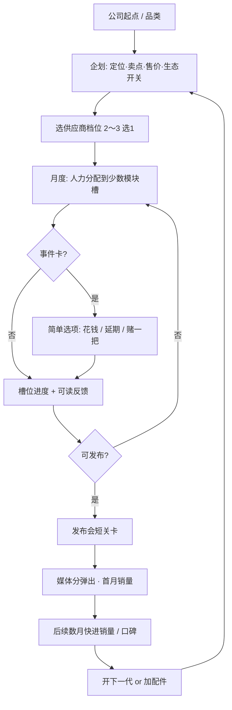

# 《科技公司模拟器》游戏设计文档

> 状态：设计讨论中 · 版本：v0.3（锁定轻松开罗风）· 最后更新：2026-11-01  
> 开放问题见 [DISCUSSION.md](./DISCUSSION.md)  
> 备注：原「留学模拟器」方向已废弃。

---

## 0. 已决议（写死）

| 项 | 决议 |
|----|------|
| **体验手感** | **轻松开罗风**（对标《游戏发展国》短循环），**不是**硬核供应链 / ERP 模拟 |
| 反馈原则 | 短循环、可读反馈、岗位/企划有梗、失败可快速重来 |
| 供应链定位 | **事件卡 + 2～3 档供应商简单选项**；不做深度 BOM 表、精细库存算法、多级物流 |
| 数值友好 | 研发用**少数清晰槽位** + 人才组合；玩家一眼看懂加减 |

详见 [DISCUSSION.md Q4](./DISCUSSION.md)（已拍板）。

---

## 1. 愿景与定位

### 1.1 产品一句话

《科技公司模拟器》（暂定名；候选见 DISCUSSION：果核 / 键程 / Product Lab / Gadget Corp）是一款**轻松开罗式回合 / 月度经营**：组建有梗的团队、用少数模块槽研发电子产品、用简单供应商档位与事件卡「过」供应链、办一场爽快的发布会、看媒体分与月销量——核心是「把一款电子产品从概念做到货架」，节奏像发展国，不是公司 Excel。

### 1.2 目标体验（已锁定）

| 关键词 | 含义 |
|--------|------|
| 短循环上瘾 | 企划 → 研发 → 事件 → 发布 → 销售 → 下一代，一局想再开 |
| 可读反馈 | 槽位、评分、销量用大数字与短评，少隐藏公式 |
| 权衡有痛感但不折磨 | 体验 ↔ 成本 ↔ 出货时间三角存在，但选项清晰 |
| 供应链是戏剧不是作业 | 缺芯/良率用**一张事件卡**改剧本，不填表 |
| 发布与销量要爽、要快 | 媒体分弹出、月销量曲线一眼懂 |
| 轻幽默科技感 | 岗位与企划有梗；不山寨真实商标外观 |

### 1.3 受众

- 喜欢开罗《游戏发展国》、Game Dev Tycoon 等短循环经营的玩家
- 对消费电子、发布会八卦有兴趣、但不想学 ERP 的人
- **非目标**：硬核供应链/财务模拟党、开放世界探索党、纯视觉小说党

### 1.4 核心创意卖点

1. **轻量三角权衡**：体验 ↔ 成本 ↔ 出货时间（抽象成本条即可，不做精细 BOM 行项目）  
2. **供应链戏剧性（事件向）**：缺货、良率、泄露用事件卡推动，保留开罗式「糟了！」瞬间  
3. **生态与自相蚕食（简化）**：新品太强砸旧款销量；封闭/开放点一下有后果  
4. **发布会关卡要爽**：短选项、Demo 风险、彩蛋 vs 务实，立刻出媒体分  
5. **人才有梗**：工业设计、硬件 PM、射频、供应链、公关等岗位组合，招人像发展国

---

## 2. 为何是轻松开罗式（及主题差异）

### 2.1 手感锚点：开罗《游戏发展国》

- 短循环、岗位人才、**企划 → 开发 → 评价 → 销售**清晰上瘾  
- 紧凑 UI + 关键事件；失败重开成本低  
- **已决议**：深度对标此手感，供应链只作题材调味，不升级成模拟经营硬核盘

### 2.2 电子产品题材差异（仍保持轻松）

| 发展国侧 | 本作（轻松版） |
|----------|----------------|
| 题材 × 方向加点 | **少数**硬件模块槽 + 人才加成 |
| 工期与评价 | 抽象「成本条 / 风险条」+ 事件卡（缺芯、良率、认证、泄露） |
| 发售后销量 | **快反馈**媒体分 + 月销量；库存用简单「备货偏多/偏少」档，不做精细算法 |
| 续作 | 下一代 + 轻微自相蚕食；配件/生态用开关与少量数值 |

### 2.3 明确不做的形式

- 开放世界园区漫游、纯视觉小说  
- 硬核供应链、精细 BOM 表、多级库存/物流 ERP  
- 完整财报、真实芯片制程节点树、实时股价盘  

---

## 3. 核心玩法循环

### 3.1 闭环步骤（轻松版）

1. **公司与品类**：选起点（车库 / 小品牌 / 已有产品线）；品类先手机，再加一配件  
2. **企划**：定位（旗舰/主流/极简/专业）、卖点标签、售价带、是否绑上代生态——选项有梗、少填空  
3. **研发分配**：每月把人力丢进**少数清晰槽位**（见 4.1）；人才决定效率与彩蛋  
4. **供应链（薄）**：开研发前或中段选 **2～3 档供应商**；过程中抽**事件卡**（缺芯、良率、模具、认证、泄露）做简单选项  
5. **发布与销售（爽快）**：短发布会关卡 → 立刻媒体分/用户分 → 数个月销量与口碑，节奏快  
6. **世代循环**：开下一代；旧款用「清仓 / 以旧换新 / 不管」等简单策略；信仰值轻量累积

### 3.2 流程（Mermaid）



### 3.3 一局节奏

- **教程机**：一个机型、一次供应商选择、一张事件、一场发布会——教会三角与爽感  
- **首款旗舰年**：多几个事件 + 舆情梗，仍然短  
- **配件 / 二代**：教生态开关与轻微自相蚕食，不引入复杂库存系统  

---

## 4. 系统拆解（按轻松开罗收紧）

### 4.1 研发槽：少数清晰槽位

MVP **建议 5 槽**（可合并，避免七七八八记不住）：

| 槽位 | 玩家能看懂的反馈 |
|------|------------------|
| 性能 | 跑分感 / 「快不快」短评 |
| 屏幕与外观（ID） | 好看分、信仰感 |
| 影像 | 发布会话题、Demo 翻车率 |
| 续航与稳定 | 口碑长尾、返修抱怨 |
| 系统与生态 | 软硬一体分、配件加成 |

人才站在槽上 = 加速或触发趣味事件。  
**成本 / 时间**用两条总表进度（或一个「量产压力」条）汇总，**不**让玩家填 BOM 明细。

### 4.2 供应链：档位 + 事件卡（已锁定薄实现）

- **供应商**：约三档——便宜不稳 / 均衡 / 贵但稳；选一次，影响事件频率与成本条  
- **事件卡**：缺芯、良率糟了、模具延期、认证卡住、样机泄露等；每张 2～3 个选项（加钱、延期、降规格、赌）  
- **备货**：发布前选「保守 / 正常 / 激进」一档即可；结果用销量月报里的短句反馈（缺货黄牛 / 仓库吃灰）  
- **MVP 不做**：多级 BOM、良率曲线编辑、合约年限模拟、精细 SKU 库存算法、关税物流表  

### 4.3 财务（极简）

- 只保留：现金、每机抽象成本、售价、本月盈亏大字  
- 服务订阅可做后期一个开关（+小额月入）  
- **排除**：精细科目、税务、全球财报  

### 4.4 品牌、舆情、信仰值

- 媒体分、用户分大字弹出；信仰值缓慢涨跌  
- 泄露 / 翻车用事件或发布会选项触发，文案有梗  

### 4.5 人才与组织

- 岗位示例：工业设计、硬件 PM、影像、系统、供应链、公关  
- 招聘界面像发展国：看星级与一句性格梗  
- 组合影响槽位速度与发布会稳定度；疲劳/挖角可极简或后置  

### 4.6 产品线与自相蚕食（轻）

- 二代或配件上市时，旧款销量自动打折扣（规则透明的一小段说明）  
- 玩家用「降价清仓 / 以旧换新活动 / 停产」三选一应付  
- 生态：封闭 / 开放一个开关，影响配件收入与骂名事件率  

### 4.7 发布会与销售反馈（要爽、要快）

- **会前**：少量准备选项（Demo 加稳、加彩蛋、加参数稿）  
- **会中**：2～4 个节点选项，立刻反馈「全场欢呼 / 冷场 / 死机」  
- **会后**：媒体分、用户期待条、首月销量预估 **同一屏结算**  
- **月销量**：数月快进或一键看完曲线，少点确认  

---

## 5. 进度结构

```text
公司创建（轻松三起点或先做一起点）
   ↓
教程机（三角 + 供应商档 + 一事件 + 发布会爽感）
   ↓
旗舰年（多事件，仍短循环）
   ↓
配件 / 二代（生态开关 + 轻自相蚕食）
   ↓
结局标签（创新偶像 / 发布会之神 / 仓库传说 …）
```

---

## 6. 美术 / 叙事基调

- 简洁科技 UI 或像素开罗致敬风（待 DISCUSSION 美术题）  
- 文案轻幽默；岗位与企划文案优先「有梗」  
- 全面虚构品牌；禁止山寨真实商标与标志性外观  

---

## 7. MVP 范围与非目标

### 7.1 MVP 应有

- [ ] 完整轻循环：企划 → 少槽研发 → 供应商档 → 事件卡 → 发布会 → 快销反馈 → 可开二代  
- [ ] 三角权衡可视化（体验 / 成本 / 时间）  
- [ ] 5 个以内研发槽 + 4～6 岗人才  
- [ ] 供应链事件子集（至少缺芯、良率、泄露各能抽到）  
- [ ] 发布会短关卡 + 媒体分大字 + 月销量快反馈  
- [ ] 备货三档（非精细库存）  
- [ ] 中文可玩；失败重开友好  

### 7.2 明确排除（含本决议加严）

- 精细财务 / 税务 / 全球财报  
- 真实芯片制程 / 工艺节点科研树  
- 实时股价或硬核资本市场盘  
- 精细 BOM 行项目、多级库存与物流 ERP  
- 开放世界园区、真实商标与写实机模复刻  
- 联机对战  

---

## 8. 参考灵感

| 参考 | 借鉴 | 不借鉴 |
|------|------|--------|
| 开罗《游戏发展国》 | **主手感**：短循环、岗位、企划-评价-销售 | 具体数值与文案 |
| Game Dev Tycoon | 口碑与销量经营的轻松感 | 过深系统 |
| 异星工厂等 | 仅「瓶颈」直觉的文案隐喻 | 工厂建造玩法 |
| 消费电子常识 | 发布会、缺芯、良率等梗的抽象事件 | 真实公司数据与受保护文案 |

---

## 9. 开放问题

手感与供应链深度 **已锁定**。其余见 **[DISCUSSION.md](./DISCUSSION.md)**（游戏名、平台、虚构品牌、美术等）。

---

## 附录：术语

| 术语 | 含义 |
|------|------|
| 轻松开罗风 | 短循环、可读、有梗、易重开；非硬核模拟 |
| 三角权衡 | 体验 ↔ 成本 ↔ 出货时间（抽象条） |
| 供应商档 | 2～3 档简单选择，非合约模拟器 |
| 信仰值 | 轻量品牌忠诚抽象 |
| 自相蚕食 | 新品轻轻砸旧款销量的透明规则 |
